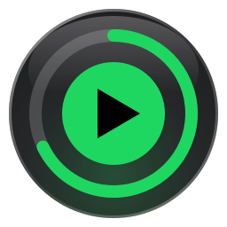
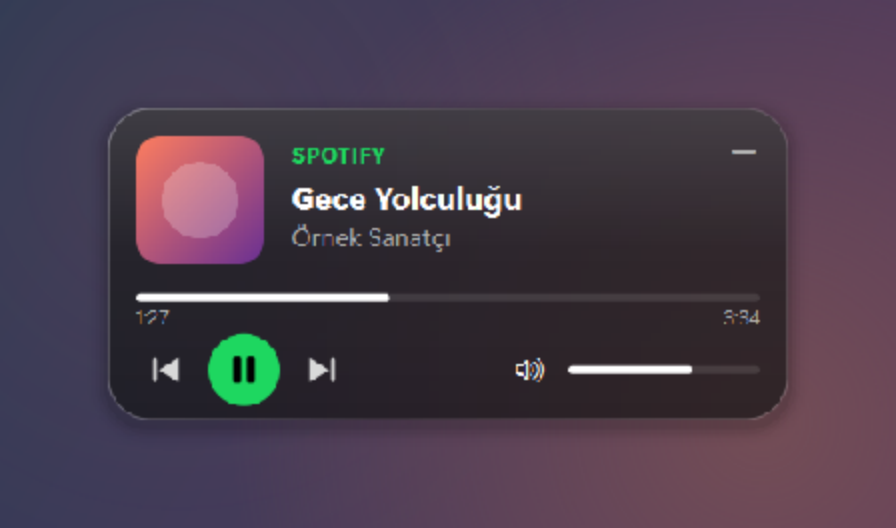
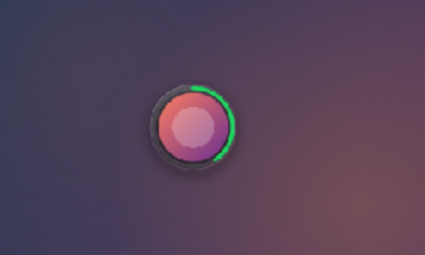
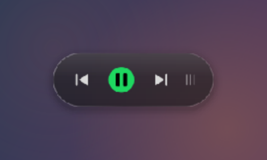
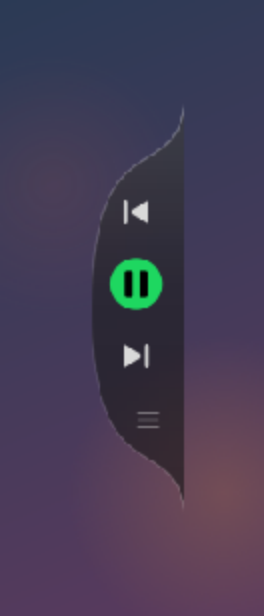

<p align="center">
  
</p>

<h1 align="center">Medya Panel</h1>

<p align="center">
  Windows için ekranda yüzen, cam görünümlü küçük bir medya ve ses kontrolü.<br>
  Spotify, YouTube ve tarayıcıdaki videolar dahil, Windows'un medya kontrolüne düşen her şeyle çalışır.
</p>

<p align="center">
  
</p>

## Neler yapar

Panel ekranın herhangi bir yerinde küçük bir balon olarak durur. Balonun içinde çalan şarkının kapağı, etrafında da yeşil bir ilerleme halkası görünür.

| Balon | Üzerine gelince | Tıklayınca |
|:---:|:---:|:---:|
|  |  |  |
| Kapak ve ilerleme halkası | Önceki, oynat/duraklat, sonraki ve bir tutma yeri | Şarkı bilgisi, ileri-geri sarma, ses ayarı |

**Kenara yapıştırma.** Balonu ekranın bir kenarına yakın bırakırsan akıp kenara yapışan bir damlaya dönüşür. Fareyi üzerine getirince damla uzar ve düğmeler belirir, yani tıklamadan şarkı değiştirebilirsin. Sürükleyip uzaklaştırınca damla kenardan kopar ve tekrar balon olur.

<p align="center">
  
  &nbsp;&nbsp;&nbsp;
  
</p>

**Diğer özellikler**

- Her zaman diğer pencerelerin üstünde durur. Arkası bulanık cam gibi görünür.
- Fare tekerleğiyle ses açılıp kısılır, yüzde düğmenin içinde görünür.
- Renkler Spotify paletinden: çubuklar beyazdır, üzerine gelince yeşile döner.
- Açılma, kapanma, kenara akma ve sürükleme geçişlerinin hepsi animasyonludur.
- Konumunu ve hangi kenarda durduğunu hatırlar. Aynı anda yalnızca bir kopyası açılır.

## Kısayollar

| Ne | Nasıl |
|---|---|
| Kartı aç | Balona tıkla |
| Kartı kapat | `Esc`, küçültme düğmesi ya da başka bir yere tıklamak |
| Taşı | Balonu ya da çizgili tutma yerini sürükle |
| Oynat / duraklat | Düğmeler ya da kart açıkken `Boşluk` |
| Ses | Fare tekerleği ya da karttaki ses çubuğu |
| Paneli kapat | Sağ tık, sonra **Kapat** |

## Kurulum

### Hazır exe ile (önerilen)

1. [Releases](../../releases) sayfasından `Medya.Panel.exe` dosyasını indir.
2. Çift tıklayıp aç. Python ya da başka bir şey kurman gerekmez.

Exe imzasız olduğu için ilk açılışta Windows *"Windows bilgisayarınızı korudu"* uyarısı verebilir. **Ek bilgi**, sonra **Yine de çalıştır** demen yeterli.

Windows açılınca kendiliğinden başlasın istersen `Win + R` ile `shell:startup` klasörünü aç ve exe'nin bir kısayolunu oraya koy.

### Kaynaktan çalıştırma

Python 3.10 veya üstü gerekir.

```bash
git clone https://github.com/mertbrks/medya-panel.git
cd medya-panel
pip install -r requirements.txt
pythonw medya_panel.py
```

Konsol penceresi açılmasın diye `python` yerine `pythonw` kullanılıyor.

### Exe'yi kendin derlemek

```bash
pip install pyinstaller
pyinstaller --onefile --windowed --name "Medya Panel" --icon medya_panel.ico ^
  --collect-submodules winrt --collect-submodules pycaw --collect-submodules comtypes ^
  medya_panel.py
```

Çıktı `dist/Medya Panel.exe` olur. Logo `make_icon.py` ile üretilir.

## Nasıl çalışır

- **Arayüz:** PySide6 ile çerçevesiz, saydam bir pencere. Her şey `QPainter` ile çiziliyor.
- **Medya:** Windows'un `GlobalSystemMediaTransportControlsSessionManager` arayüzü (`winrt` paketleri) üzerinden şarkı bilgisi, kapak ve oynatma kontrolü.
- **Ses:** Sistem sesi [pycaw](https://github.com/AndreMiras/pycaw) ile ayarlanıyor.
- **Cam efekti:** Pencerenin arkasındaki ekran yakalanıp bulanıklaştırılıyor. Panel kendini ekran yakalamasının dışında tuttuğu için ekran görüntülerinde ve ekran paylaşımında görünmez.

## Bilinen sınırlar

- Yalnızca Windows 10 ve 11'de çalışır.
- Ses ve küçültme ikonları Windows 11'deki *Segoe Fluent Icons* yazı tipinden geliyor. Windows 10'da bu ikonlar kutu gibi görünebilir.
- Ses düğmesi uygulamanın değil, sistemin ana sesini ayarlar.
